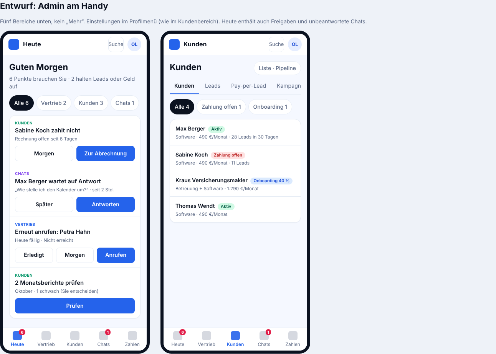
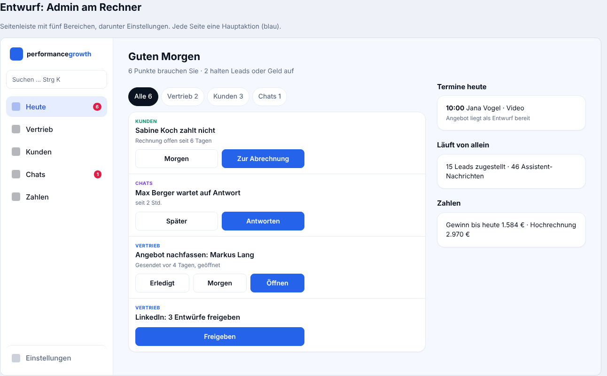
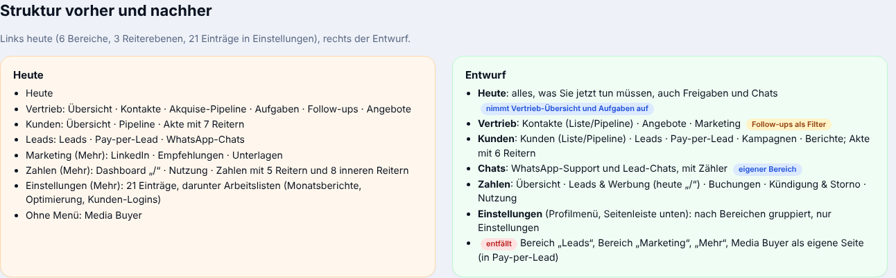
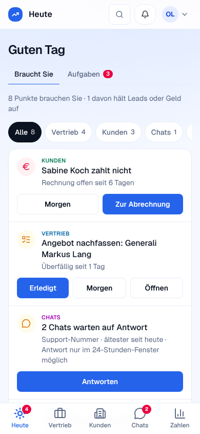
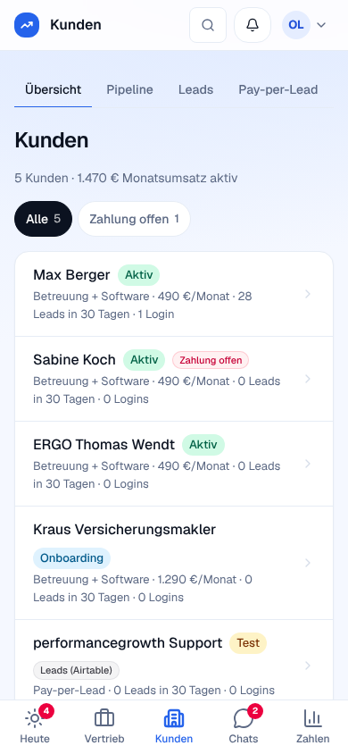
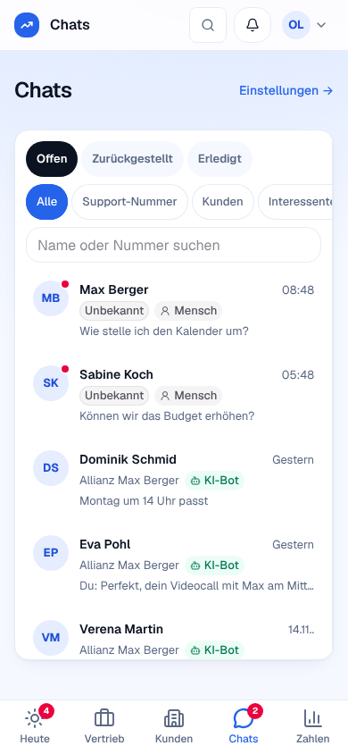
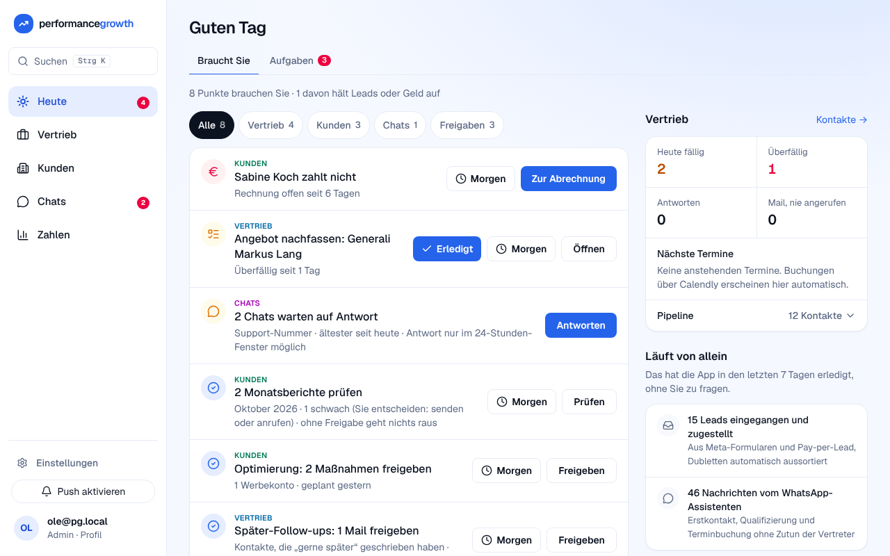

# Admin-Makeover, Runde 1 (16.11.2026)

Auftrag (Ole): „Den Adminbereich einem kompletten UX/UI-Makeover unterziehen. Es gibt super viele Funktionen und
Menüpunkte, die alle neu durchdacht werden. Der Adminbereich soll so intuitiv und einfach sein wie der Kundenbereich.
Ziel: Usability-Wert 90.“

Runde 1: Bestandsaufnahme, Aufgaben mit Klickzahlen, SUS-Schätzung, Entwurf einer neuen Struktur, sofort umgesetzt
nur, was gewohnte Wege nicht verändert. Strukturänderungen am Menü sind **nur Vorschlag** (Abschnitt 5 und 7).

Methode wie beim Kundenbereich (`docs/ux/2026-11-16-pruefung-kundenapp.md`): jede Admin-Seite auf 390 und 1280 px mit
Playwright, programmatisch (Querscrollen, Überlauf, Tippziele unter 40 px, Gedankenstriche, englische Reste,
Konsolenfehler, Hauptaktionen je Seite) und per Screenshot; Bewertung nach den zehn Heuristiken von Nielsen, als
SUS-Schätzung (keine Messung). Daten: Kopie der Demo-DB (`ux_demo_aaf`) mit Demo-Kunde Max Berger, dazu 3 weitere
Kunden, 12 Vertriebskontakte in allen Stufen, Aufgaben, Angebote und Monatsberichte. Stand `origin/claude/whatsapp-crm`
ab 08ee0b7.

Nutzungsmessung: `lib/usage.ts` misst nur den Kundenbereich (je Kunde, ohne Admin). Was Ole im Admin wirklich nutzt,
ist deshalb aus `git log` (welche Bereiche wie oft und auf wessen Wunsch geändert wurden), den Einträgen auf „Heute“
und den Notizen in `docs/` geschätzt. Vorschlag: Admin-Seitenaufrufe pseudonym mitmessen (Abschnitt 7, Punkt 6).

Screenshots: `/tmp/claude-0/-home-user-kpidashboard-pg/5666182b-f0f3-50fb-a1b4-146b28494aa3/scratchpad/admin-ux/shots/`
(`r0-` Ausgangsstand, 16 Seiten am Handy; `r1-` Zwischenstand am Handy; `r2-` Endstand, 63 Seiten auf 390 und 1280 px, Produktions-Build; `q-` Einzelbilder).
Entwurf als Bilder im Repo: `docs/ux/bilder/admin-entwurf-handy.png`, `-rechner.png`, `-karte.png`
(Quelle `docs/ux/admin-makeover-entwurf.html`).

## 1. Bestandsaufnahme

15 Bereiche, 63 Seiten (davon 2 reine Weiterleitungen). Im Menü: 6 Bereiche plus Einstellungen; am Handy 4 unten und
„Mehr“ (Marketing, Zahlen, Einstellungen). Häufigkeit: **T** täglich, **W** wöchentlich, **M** monatlich, **S** selten
(Einrichtung, einmalig). Begründung der Häufigkeit in der letzten Spalte, wo sie nicht offensichtlich ist.

### Heute und Vertrieb

| Seite | Zweck | Hauptaktion heute | Häuf. | Überschneidung / Befund |
|---|---|---|---|---|
| `/admin/heute` | Alles, was Ole tun muss, aus allen Bereichen | oberster Eintrag (z. B. „Zur Abrechnung“) | T | Gut. Fehlen: Monatsberichte zum Prüfen, Optimierung zur Freigabe, Follow-ups zur Freigabe, unbeantwortete Chats. Begrüßung war immer „Guten Abend“ (behoben). |
| `/admin/vertrieb` (Übersicht) | Fällige Aufgaben, Termine, Pipeline-Zahlen | „+ Neuer Lead“ | T | Doppelt zu Heute (Aufgaben, Termine) und zu Zahlen (Pipeline). Drei Einstiege für „was ist heute dran“: Heute, Vertrieb-Übersicht, Aufgaben. |
| `/admin/vertrieb/kontakte` | Kontakt suchen, filtern | „+ Neuer Lead“ | T | Am Handy 9-Spalten-Tabelle und vier Filterfelder vor der Liste (behoben). |
| `/admin/vertrieb/kontakte/[id]` | Kontakt: anrufen, Aktivität, Aufgaben, Angebot | „Aktivität erfassen / Speichern“ | T | Sehr lang, aber gegliedert (Aufklappen gemerkt). Auch in der Kundenakte eingebettet. |
| `/admin/vertrieb/kontakte/neu` | Neuen Kontakt anlegen | „Speichern“ | W | |
| `/admin/vertrieb/kontakte/[id]/angebot` | Angebot erstellen | „Senden“ | W | Häufigster Commit-Anlass im Vertrieb (Ole). |
| `/admin/vertrieb/kontakte/[id]/praesentation` | Vertriebspräsentation, Link an Interessenten | „Link erstellen“ | W | |
| `/admin/vertrieb/pipeline` | Akquise-Kanban | Karte ziehen | W | Gleiche Daten wie Kontakte, andere Ansicht. Im Kundenbereich ist das ein Umschalter „Liste/Pipeline“, hier ein eigener Reiter. |
| `/admin/vertrieb/aufgaben` | Alle offenen Aufgaben | Haken | T | Doppelt zu Heute (Filter „Vertrieb“) und Vertrieb-Übersicht. |
| `/admin/vertrieb/follow-ups` | Später-Follow-ups, Einstellungen | „Freigeben“ / „Speichern“ | W | Mischt Arbeitsliste und Einstellungen; Einstellungen zusätzlich über Einstellungen → Später-Follow-ups (Sprungmarke). |
| `/admin/vertrieb/angebote` | Alle Angebote | Angebot öffnen | W | „Angebot nachfassen“ steht auch auf Heute. |
| `/admin/vertrieb/import` | Anbindungen (Instantly, Calendly, Formulare) | „Abgleichen“ | S | Liegt unter Vertrieb, ist aber Einstellung (so auch im Menü einsortiert). Am Handy 414 px breit (lange Variablennamen). |
| `/admin/vertrieb/kunden` | Weiterleitung auf Kunden-Pipeline | | | entfällt (Altlast) |

### Kunden

| Seite | Zweck | Hauptaktion heute | Häuf. | Überschneidung / Befund |
|---|---|---|---|---|
| `/admin/kunden` | Alle Kunden mit Status, Filter | Kunde öffnen | T | Gut (Liste, Filter-Chips, Warnungen). |
| `/admin/kunden/pipeline` | Kunden-Kanban (Vertrag bis Gekündigt) | Karte ziehen | W | Wie Vertrieb: Ansicht derselben Liste als eigener Reiter. |
| `/admin/kunden/[id]` (Übersicht) | Kundenakte: Status, Einrichtung, Kontakt, Verlauf | „Anrufen“ / Aktivität | T | Fünf Einstellungs-Karten standen vor Kontakt und Verlauf (am Handy etwa 1.100 px), jetzt zugeklappt (behoben). |
| `…/leads` | Formulare, Leads, Meta-Werbekonto, Rückmeldung an Meta | „Speichern & prüfen“ | W | Am Handy 470 px breit (behoben). |
| `…/kampagne` | Kampagne (KI) | | W | |
| `…/optimierung` | Optimierung des Werbekontos | „Freigeben“ | W | Doppelt zu `/admin/optimierung/[id]` (gleiche Ansicht). |
| `…/whatsapp` | WhatsApp-Assistent des Kunden | | S | Eingebettete WhatsApp-Einstellungen. |
| `…/logins` | Logins & Team | „Login anlegen“ | S | Eingebettete Seite `/admin/buyers?kunde=…`; dieselbe Seite steht ohne Kunde in Einstellungen → Kunden-Logins. |
| `…/abrechnung` | Abrechnung, Pause, Module, Kündigung | je Karte | W | |
| `/admin/monatsberichte` | Monatsberichte prüfen und senden | „Senden“ / „Lieber anrufen“ | M | Arbeitsliste, aber nur über Einstellungen erreichbar; nicht auf Heute. |
| `/admin/monatsberichte/[id]` | Ein Bericht | „Senden“ | M | |
| `/admin/optimierung` | Alle Werbekonten, letzte Maßnahme | Konto öffnen | W | Arbeitsliste unter Einstellungen; Freigaben nicht auf Heute. |
| `/admin/optimierung/[id]` | Maßnahmen je Konto | „Alle freigeben“ | W | |
| `/admin/buyers` | Kunden-Logins aller Kunden | „Login anlegen“ | S | siehe `…/logins` |

### Leads, Pay-per-Lead, Chats

| Seite | Zweck | Hauptaktion heute | Häuf. | Überschneidung / Befund |
|---|---|---|---|---|
| `/admin/leads` | Alle Leads aller Kunden, CSV | „CSV exportieren“ | W | Am Handy 7-Spalten-Tabelle (behoben). Gehört inhaltlich zu Kunden (Lieferung prüfen) bzw. Zahlen. |
| `/admin/ppl` | Pay-per-Lead: Bezüge, Übersicht, Auswertung, Geparkt, Storno, Geliefert, Eingang | „Bezug anlegen“ | W | 7 innere Reiter unter 3 äußeren. Geparkt und Storno stehen auch auf Heute. |
| `/admin/ppl/bezug/[id]`, `/admin/ppl/import` | Bezug bearbeiten, Import aus Airtable | „Speichern“ / „Übernehmen“ | S | |
| `/admin/whatsapp` | WhatsApp-Chats (Support-Nummer, Lead-Chats aller Kunden) | „Senden“ | T | Liegt unter „Leads“, obwohl es vor allem der Support-Posteingang ist. Kein Zähler im Menü. |
| `/admin/whatsapp/settings` | Nummern, Vorlagen, Assistent je Kunde | je Karte | S | |
| `/admin/lead-eingang` | Meta-Verbindung, Formulare zuordnen | „Zuordnen“ | S | Unzugeordnete Formulare stehen auf Heute. |

### Marketing, Zahlen, Einstellungen

| Seite | Zweck | Hauptaktion heute | Häuf. | Überschneidung / Befund |
|---|---|---|---|---|
| `/admin/marketing/linkedin` | KI-Entwürfe freigeben, Reichweite | „Freigeben“ | T | Freigaben stehen auch auf Heute. Am Handy unter „Mehr“. |
| `/admin/marketing/empfehlungen` | Kollegen-Empfehlungen, Prämien | „Prämie auszahlen“ | M | Einstellungen dazu unter Einstellungen → Kollegen empfehlen. |
| `/admin/marketing/unterlagen` (+ Präsentation) | Präsentationen für Interessenten | Herunterladen | W | Präsentation auch im Kontakt. |
| `/` (Dashboard) | Lead-Kennzahlen, Werbung, Pay-per-Lead | Zeitraum wählen | W | Heißt im Menü nicht „Dashboard“; erreichbar über die Zahlen-Karte auf Heute und „Alle Lead-Kennzahlen“ in Zahlen; zusammen mit „Nutzung“ in eigenen Reitern. |
| `/admin/zahlen` (+ Buchungen, Stornoquote, Kündigung & Rückkehr, WhatsApp-Zustellung) | Geschäftszahlen, Investoren | „Investoren-Update“ | W | Zwei Reiterebenen (5 außen, 8 innen). |
| `/admin/nutzung` | Nutzung des Kundenbereichs, Feedback, Hilfe-Anfragen | | W | Hilfe-Anfragen an das Team stehen auch auf Heute. |
| `/admin/media-buyer` | Budgets der Pay-per-Lead-Pools | „Anwenden“ | ? | Nicht im Menü, nur über Push-Mitteilung erreichbar; eigener Stil mit Emojis. |
| `/admin/einstellungen` (+ 16 Unterseiten) | Einstellungen in 5 Gruppen, 21 Einträge | Eintrag öffnen | S | Enthält Arbeitslisten (Monatsberichte, Optimierung, Kunden-Logins) und Inhalte für Kunden (Neuigkeiten, Login-Karten, Status). |

### Gemessene Befunde (Ausgangsstand, 390 px)

- Tippziele unter 40 px: im Mittel 18 je Seite (16 Seiten gemessen; Kopfzeile 2, Reiter 6 bis 7, Fußzeile 4, Aufgaben je Zeile 4).
- Querscrollen: Kundenakte → Leads (470 px), Vertrieb → Anbindungen (414 px).
- Rund 30 verschiedene Zurück-Links („← Einstellungen“ klein grau, klein blau, „← Zurück“, „← zum Dashboard“).
- Kein Ladezustand und keine Fehlerseite im Admin (beim Tippen blieb die alte Seite stehen; bei einem Fehler die leere
  Next-Fehlerseite ohne Menü).
- Drei Reiter-Stile: Unterstrich (Kunden, Leads, Zahlen), blau gefüllt (Vertrieb, Marketing), Chips (Heute, Kunden-Filter).
- Emojis statt Symbolen (Pipelines, Kontakt, Media Buyer), entgegen `docs/design-system.md`.
- Die Admin-Suche kannte 25 von 63 Seiten.

### Gemessen nach Runde 1 (r2, 63 Seiten inkl. Detailseiten, Produktions-Build)

- Tippziele unter 40 px am Handy: im Mittel 2,8 je Seite (vorher 18). Der Rest liegt fast nur in seltenen
  Einstellungen (WhatsApp-Einstellungen, Rechner) und an Kanban-Karten. Mitgezählt sind auch Elemente, die nur
  optisch kleiner sind und eine unsichtbar vergrößerte Tippfläche haben („+1 Tag“, Aufgaben-Filter).
- Querscrollen am Handy: keine Seite mehr (Änderungsprotokoll war 608 px, nach r2 behoben).
- Keine Konsolenfehler; Gedankenstriche nur in internen Admin-Texten (erlaubt). Ein Monatsbericht mit
  unvollständigen Demo-Daten zeigte die neue Fehlerseite statt der leeren Next-Seite (Bild `r2-390-admin_monatsberichte_demo_mr_2.png`).
- Seitenhöhe am Handy: Kundenakte 3.455 → 2.743 px, Vertrieb → Kontakte 1.716 → 1.500 px (mit Liste statt Tabelle),
  Heute 1.562 → 1.369 px (ohne Fußzeile).

## 2. Die wichtigsten Aufgaben von Ole

Klicks ab Start (Heute), ohne Tippen von Text. „Heute“ = Stand vor Runde 1, „Entwurf“ = mit der Struktur aus Abschnitt 5.

| # | Aufgabe | Häuf. | 390 heute | 1280 heute | Entwurf (beide) | Stolperstelle |
|---|---|---|---|---|---|---|
| 1 | Morgens sehen, was zu tun ist | T | 0 | 0 | 0 | Freigaben und Chats fehlen auf Heute; Vertrieb-Übersicht und Aufgaben zeigen Ähnliches. |
| 2 | Fälligen Vertriebskontakt anrufen und Ergebnis eintragen | T | 2 (Heute: Anrufen; danach Kontakt öffnen, Aktivität) + Formular | 2 + Formular | 2 + Formular | gut |
| 3 | Kontakt suchen und öffnen | T | 3 (Vertrieb, Kontakte, Treffer) oder 2 über die Lupe | 3 bzw. 2 | 2 | Am Handy vier Filterfelder und Tabelle (behoben) |
| 4 | Support-Chat auf WhatsApp beantworten | T | 3 (Leads, Reiter WhatsApp-Chats, Chat) | 3 | 2 (Chats, Chat) | Chats liegen unter „Leads“, ohne Zähler |
| 5 | Angebot erstellen und senden | W | 5 (Vertrieb, Kontakte, Kontakt, Angebot erstellen, Senden) | 5 | 4 | gut, aber tief |
| 6 | Kunden mit offener Zahlung klären | W | 1 (Heute: Zur Abrechnung) | 1 | 1 | gut |
| 7 | Monatsberichte prüfen und senden | M | 5 (Mehr, Einstellungen, Monatsberichte, Bericht, Senden) | 4 | 2 (Heute: Prüfen, Senden) | in Einstellungen versteckt |
| 8 | Optimierung je Werbekonto freigeben | W | 5 (Mehr, Einstellungen, Optimierung, Konto, Freigeben) | 4 | 2 | in Einstellungen versteckt |
| 9 | LinkedIn-Entwürfe freigeben | T | 2 (Heute-Eintrag, Freigeben) bzw. 4 über Mehr, Marketing | 2 | 2 | gut über Heute |
| 10 | Geschäftszahlen ansehen (MRR, Gewinn) | W | 2 (Mehr, Zahlen) | 1 | 1 | Lead-Kennzahlen liegen woanders („/“) |
| 11 | Kunden-Login anlegen oder Passwort zurücksetzen | S | 3 (Kunden, Kunde, Reiter Logins; Reiter am Handy außerhalb des Bildes) | 3 | 3 | Reiter am Handy abgeschnitten (behoben: aktiver Reiter rückt ins Bild) |

## 3. SUS-Schätzung heute

Maßstab wie beim Kundenbereich (1 bis 10 je Bereich; Gesamt als SUS-Schätzung). Ehrlich: Der Admin ist für einen
Nutzer gebaut, der jede Seite selbst bestellt hat. Für Ole ist er gut erlernbar, aber nicht „ohne Erklärung“: Wichtige
Arbeitslisten liegen in Einstellungen, es gibt drei Wege zu den Aufgaben und zwei Zahlen-Seiten.

| Bereich | vorher | nach Runde 1 | Begründung |
|---|---|---|---|
| Heute | 8 | 8,5 | Eine Liste, eine Aktion je Eintrag, Rückgängig. Abzug: Freigaben (Berichte, Optimierung, Follow-ups) und Chats fehlen; Begrüßung falsch (behoben). |
| Vertrieb | 6,5 | 7,5 | Kontakte am Handy kaum nutzbar (behoben), drei Einstiege für Aufgaben, eigener Reiter-Stil (behoben), Follow-ups mit sechs Zeilen Erklärung (behoben). |
| Kunden (Liste, Akte) | 7 | 8 | Liste gut. Akte: Einstellungen vor Kontakt (behoben), 7 Reiter, am Handy abgeschnitten (aktiver Reiter jetzt sichtbar), Leads-Reiter mit Querscrollen (behoben). |
| Leads, Pay-per-Lead | 6 | 7 | Leads-Tabelle am Handy (behoben); Pay-per-Lead mit 7 inneren Reitern unter 3 äußeren bleibt. |
| WhatsApp-Chats | 6,5 | 7 | Gute Chat-Ansicht, aber unter „Leads“ versteckt, ohne Zähler; Filter-Chips 22 px (behoben). |
| Marketing | 7 | 7,5 | LinkedIn gut über Heute erreichbar; eigener Reiter-Stil (behoben). |
| Zahlen | 6,5 | 7 | Inhaltlich stark, aber zwei Zahlen-Seiten („/“ und Zahlen), Nutzung als dritte; zwei Reiterebenen (Struktur, nicht verändert). Reiter und Umschalter jetzt 40 px. |
| Einstellungen | 6 | 7 | Gruppen helfen; abgeschnittene Beschreibungen (behoben), uneinheitliche Zurück-Links (behoben). Abzug bleibt: Arbeitslisten zwischen Einstellungen. |
| Übergreifend (Laden, Fehler, Suche, Tippziele) | 5,5 | 8 | Kein Ladezustand, keine Fehlerseite, stumme Fehlermeldungen, Suche fand 25 von 63 Seiten, 18 kleine Tippziele je Seite. Behoben; Tippziele jetzt 2,8 je Seite, vor allem in seltenen Einstellungen. |
| **Gesamt (SUS-Schätzung)** | **ca. 66** | **ca. 74** | Für 90 braucht es die Struktur aus Abschnitt 5: fünf Bereiche, Arbeitslisten raus aus Einstellungen, Freigaben und Chats auf Heute. Geschätzt danach ca. 86; mit Runde 2 (Kontakt, Akte, Zahlen im Detail) ca. 90. |

## 4. Sofort umgesetzt (gewohnte Wege unverändert)

Alle Menüpunkte, Adressen und Knöpfe sind geblieben; geändert hat sich Aussehen, Größe, Text und Ordnung innerhalb
einer Seite.

| Commit | Was |
|---|---|
| 13992bf | Heute: Begrüßung nach Berliner Uhrzeit (war immer „Guten Abend“), mit Test |
| 9aab3cf | Ein Zurück-Link für alle Unterseiten (`AdminBack`, blau, Pfeil, 44 px), wie im Kundenbereich |
| a5fde48 | Ladezustand (`admin/loading.tsx`) und Fehlerseite mit „Nochmal versuchen“ / „Zu Heute“ (`admin/error.tsx`) |
| a502610 | Reiter 40 px, aktiver Reiter rückt ins Bild; Vertriebs-Knöpfe und Eingaben am Handy 40 px bzw. 16 px (kein iPhone-Zoom); keine Fußzeile mit Impressum im Admin |
| 34e568a | Tippziele 40 px (Kopfzeile, Filter-Chips, Aufgaben-Zeilen, Pipeline-Liste); lucide-Symbole statt Emojis |
| 6cbb62d | Vertrieb → Kontakte am Handy: Liste mit Anruf-Knopf statt 9-Spalten-Tabelle, weitere Filter hinter „Weitere Filter“, Löschen nur am Rechner, leere Liste mit nächster Handlung |
| b774485 | Admin-Suche findet alle Admin-Seiten (vorher 25 von 63) |
| 4a11e89 | Follow-ups: Erklärung in einem Satz, Rest aufklappbar; leere Liste erklärt |
| 289f9dc | Kundenakte: fünf seltene Einstellungs-Karten zugeklappt an derselben Stelle, mit Stand in einer Zeile (Akte am Handy 3.455 → 2.724 px) |
| 304cc84, 78e52c3 | 68 Raster ohne feste Handy-Spalte: kein Querscrollen mehr (Kundenakte → Leads 470 px, Anbindungen 414 px, Bank 453 px) |
| b8df9d8 | Leads am Handy als Liste mit Anruf-Knopf; WhatsApp-Chats: Reiter und Filter 40 px in einer Wisch-Zeile, Suche 16 px, leere Liste erklärt |
| 251c07a | Vertrieb und Marketing: derselbe Reiter-Stil wie Kunden, Leads, Zahlen; Einrichtungslisten ohne gequetschte Symbole |
| 23dd1a9 | Einstellungen: kurze Beschreibungen statt „…“, Warnhinweise in einem Satz |
| 7c1dac9 | Monatsberichte: Zurück-Link, ein Satz Erklärung, Monat blättern in einer Zeile; Monatsberichte und Optimierung markieren „Einstellungen“ im Menü |
| 6341083 | Zahlen, Aufgaben, WhatsApp-Einstellungen: Tippziele 40 px |
| 74cb0fe | Kundenakte → Abrechnung: seltene Buchungen als Zweitknöpfe (vorher 4 blaue Knöpfe) |
| 9ca7109 | „Neuer Kontakt“ statt „Neuer Lead“ im Vertrieb (ein Begriff); leere Aufgaben, Termine, Kunden-Leads mit nächstem Schritt |
| 87f9b11 | Toast-Rückmeldungen auf allen Admin-Seiten (vorher stumm außerhalb von Heute, Logins, Chat); kein `alert()` mehr |

UX-Entscheidung in zwei Sätzen (Regel vom 15.11.): Am Handy zeigt jede Liste zuerst, was man antippt (Name, Status,
Anruf-Knopf), Filter und seltene Einstellungen liegen dahinter. Keine Seite ist voller geworden; die Kundenakte ist
ein Fünftel kürzer, Kontakte und Leads passen ohne Querscrollen auf 390 px.

## 5. Entwurf: neue Informationsarchitektur (nur Vorschlag)

Grundsatz wie im Kundenbereich: fünf Bereiche unten bzw. links, Einstellungen im Profilmenü und unten in der
Seitenleiste, Heute als Start mit allem, was jetzt zu tun ist. Jede Seite eine Hauptaktion.

| Bereich | Inhalt | Hauptaktion | Woher |
|---|---|---|---|
| **Heute** | Eine Liste „Braucht Sie“ aus allen Bereichen, Filter Vertrieb / Kunden / Chats; rechts bzw. darunter Termine heute, „Läuft von allein“, Zahlen-Karte | oberster Eintrag | bisher Heute + Vertrieb-Übersicht + Aufgaben; neu auf Heute: Monatsberichte prüfen, Optimierung freigeben, Follow-ups freigeben, Chats ohne Antwort |
| **Vertrieb** | Kontakte (Umschalter Liste / Pipeline, Filter „Follow-up geplant“), Angebote, Marketing (LinkedIn, Unterlagen) | „+ Neuer Kontakt“ | Pipeline als Ansicht statt Reiter (wie Kundenbereich); Follow-up-Einstellungen in Einstellungen |
| **Kunden** | Kunden (Liste / Pipeline), Leads, Pay-per-Lead, Kampagnen (Optimierung), Berichte (Monatsberichte), Empfehlungen; Akte mit 6 Reitern (Übersicht, Leads & Kampagne, WhatsApp, Team, Abrechnung, Verlauf) | Kunde öffnen; in der Akte „Anrufen“ | Leads und Pay-per-Lead aus „Leads“; Monatsberichte und Optimierung aus Einstellungen |
| **Chats** | WhatsApp-Posteingang (Support-Nummer und Lead-Chats), Zähler im Menü | „Antworten“ | bisher Leads → WhatsApp-Chats |
| **Zahlen** | Übersicht, Leads & Werbung (heute „/“), Buchungen, Kündigung & Storno, Nutzung | „Investoren-Update“ | „/“ und Nutzung als Reiter statt eigener Seiten; WhatsApp-Zustellung zu Chats |
| Einstellungen | nach Bereichen gruppiert (Vertrieb, Kunden & Leads, Chats, Für Kunden sichtbar, Finanzen, Sicherheit); nur Einstellungen | | Arbeitslisten raus |

Was entfällt: Bereich „Leads“, Bereich „Marketing“, „Mehr“ am Handy, die Seiten Vertrieb-Übersicht und Aufgaben (in
Heute), der Reiter Akquise-Pipeline (Umschalter), die Weiterleitung `/admin/vertrieb/kunden`, Media Buyer als eigene
Seite (in Pay-per-Lead oder ganz, siehe Entscheidung 5).

Mobile zuerst: unten Heute, Vertrieb, Kunden, Chats, Zahlen (alles mit einem Tipp, kein „Mehr“); Suche und Profil oben
rechts; innerhalb eines Bereichs höchstens eine Reiterzeile; Tabellen am Handy als Liste mit Anruf-Knopf.

## 6. Nicht umgesetzt (Struktur, Entscheidung Ole)

Alles aus Abschnitt 5. Dazu, weil es Ole selbst eingeführt hat: Marketing als eigener Bereich (Ole, 14.11.: „Vertrieb
bleibt Arbeit an Kontakten“), die Knöpfe „+1 Tag / +1 Woche“ an jeder Aufgabe.

## 7. Entscheidungen für Ole

1. **Chats als eigener Hauptbereich** (mit Zähler unten), statt Leads → WhatsApp-Chats? Der Support-Posteingang ist
   täglich, liegt aber hinter einem Reiter.
2. **„Leads“ auflösen:** Leads-Liste und Pay-per-Lead unter Kunden, Lead-Dashboard („/“) und Nutzung als Reiter unter
   Zahlen?
3. **Marketing in Vertrieb** (LinkedIn und Unterlagen als Reiter, Empfehlungen zu Kunden) und Einstellungen ins
   Profilmenü, damit die Leiste ohne „Mehr“ auskommt? Alternative: Marketing bleibt eigener Bereich, dafür Zahlen ins
   Profilmenü.
4. **Ein Eingang für „was ist dran“:** Vertrieb-Übersicht und Aufgaben gehen in Heute auf; Heute bekommt Monatsberichte,
   Optimierung, Follow-up-Freigaben und unbeantwortete Chats.
5. **Arbeitslisten raus aus Einstellungen:** Monatsberichte und Optimierung zu Kunden. Media Buyer: in Pay-per-Lead
   einordnen oder entfernen (nur per Push erreichbar)?
6. (klein) Admin-Seitenaufrufe pseudonym mitmessen wie im Kundenbereich, damit Runde 2 auf Messung statt Schätzung beruht.

## 8. Nicht geprüft

- Echte Anbindungen (Meta, Instantly, Calendly, Stripe, 360dialog): lokal nicht verbunden, Seiten zeigen den
  „nicht eingerichtet“-Zustand.
- Zwei-Faktor-Login: lokal ohne TOTP angemeldet (Bootstrap-Admin); Einrichten nicht durchgespielt.
- Drag & Drop in den Pipelines am Handy.
- Erklärvideos: `tools/erklaervideos/betroffen.py 08ee0b7..HEAD` meldet keine betroffenen Seiten (kein Video zeigt den Admin).

# Runde 2 (16.11.2026): Struktur umgesetzt

Ole hat die Entscheidungen 1 bis 5 aus Abschnitt 7 nach Empfehlung getroffen. Umgesetzt in 0e1fe2b, 4ce391e, c90f977.
Grundsatz: **Funktionen nur umgezogen, nichts gelöscht; fast alle Adressen bleiben gleich.** Welche Adresse zu
welchem Bereich gehört, steht an einer Stelle (`src/lib/admin-bereiche.ts`, Test `tests/unit/admin-bereiche.test.ts`).

## 9. Neue Struktur

| Bereich | Leiste unten / Seitenleiste | Reiter |
|---|---|---|
| Heute (Zähler: Dringendes + fällige Aufgaben) | ja | Braucht Sie · Aufgaben; Filter Alle, Vertrieb, Kunden, Chats, Freigaben; rechts Karte „Vertrieb“ (Kennzahlen, Termine, neue Anfragen, Pipeline), „Läuft von allein“, Zahlen |
| Vertrieb | ja (landet auf Kontakte) | Kontakte · Akquise-Pipeline · Follow-ups · Angebote · Marketing (darunter LinkedIn, Empfehlungen, Unterlagen, Rechner) |
| Kunden | ja | Übersicht · Pipeline · Leads · Pay-per-Lead (mit Media Buyer) · Optimierung · Monatsberichte |
| Chats (Zähler: Support-Nummer wartet) | ja | eine Seite (Offen, Zurückgestellt, Erledigt; Filter Support, Kunden, Interessenten) |
| Zahlen | ja | Übersicht · Buchungen · Stornoquote · Kündigung & Rückkehr · WhatsApp-Zustellung · Leads & Werbung · Nutzung |
| Einstellungen | Profilmenü (Handy), unten in der Seitenleiste (Rechner) | nur Einstellungen; Monatsberichte (automatischer Versand) statt der Arbeitsliste, Optimierung entfernt |

Neu auf Heute: Monatsberichte prüfen, Optimierung freigeben, Später-Follow-ups freigeben (alle mit Filter
„Freigaben“, LinkedIn-Entwürfe gehören ebenfalls dazu) und Support-Chats ohne Antwort (Bereich „Chats“).
Nebenbei behoben: Der LinkedIn-Punkt ließ sich nicht auf „Morgen“ legen (Schlüssel wurde abgelehnt).

  

## 10. Alte Pfade → neue Pfade

| Alt | Neu | Wie |
|---|---|---|
| `/admin/vertrieb` (Vertrieb-Übersicht) | `/admin/heute?bereich=vertrieb` (Karte „Vertrieb“ hervorgehoben) | Weiterleitung 307 in `next.config.ts` |
| `/admin/vertrieb/aufgaben?view=…&type=…` | `/admin/heute/aufgaben?view=…&type=…` | Weiterleitung 307, Suchparameter bleiben (geprüft) |
| `/admin/leads`, `/admin/ppl`, `/admin/ppl/…` | unverändert | jetzt Bereich Kunden |
| `/admin/whatsapp` | unverändert | jetzt Bereich Chats |
| `/admin/monatsberichte`, `/admin/optimierung`, `/admin/media-buyer` | unverändert | jetzt Bereich Kunden (vorher Einstellungen bzw. ohne Menü) |
| `/admin/marketing/…` | unverändert | jetzt Reiter im Vertrieb |
| `/`, `/admin/nutzung` | unverändert | Reiter unter Zahlen |
| `/admin/vertrieb/linkedin|empfehlungen|unterlagen`, `/admin/vertrieb/kunden`, `/admin/marketing` | wie bisher weitergeleitet | |

Links im Code auf die alten Adressen angepasst (Heute-Einträge, Push bei Hilfeterminen und Termin-Review,
Buchungsliste, Angebots-Link ohne Kontakt, gemerkte Listen, Suche); ein Test durchsucht `src/` und schlägt an, wenn
wieder ein Link auf eine weitergeleitete Adresse zeigt. Texte in Push-Mitteilungen nennen die neuen Wege
(„Kunden → Pay-per-Lead“, „Vertrieb → Marketing → LinkedIn“).

## 11. Prüfrunde: Aufgaben von Ole, Klicks vorher und nachher

Klicks ab Heute (ohne Texteingabe). Korrektur zu Abschnitt 2: „Vertrieb“ führte schon vor Runde 1 direkt zu
Kontakte; Aufgaben 3 und 5 brauchten also 2 bzw. 4 Klicks, nicht 3 bzw. 5.

| # | Aufgabe | 390 vorher | 390 nachher | 1280 vorher | 1280 nachher |
|---|---|---|---|---|---|
| 1 | Morgens sehen, was zu tun ist (inkl. Freigaben, Chats) | 0, aber Freigaben und Chats fehlten | 0 | 0 | 0 |
| 2 | Fälligen Kontakt anrufen, Ergebnis eintragen | 2 + Formular | 2 + Formular | 2 + Formular | 2 + Formular |
| 3 | Kontakt suchen und öffnen | 2 | 2 | 2 | 2 |
| 4 | Support-Chat beantworten | 3 (Leads, Reiter, Chat) | 1 (Heute „Antworten“, bei einem Chat) bzw. 2 (Chats, Chat) | 3 | 1 bzw. 2 |
| 5 | Angebot erstellen und senden | 4 | 4 | 4 | 4 |
| 6 | Kunden mit offener Zahlung klären | 1 | 1 | 1 | 1 |
| 7 | Monatsberichte prüfen und senden | 5 (Mehr, Einstellungen, Monatsberichte, Bericht, Senden) | 3 (Heute „Prüfen“, Bericht, Senden) | 4 | 3 |
| 8 | Optimierung freigeben | 5 | 2 (Heute „Freigeben“, Freigeben; bei mehreren Konten 3) | 4 | 2 |
| 9 | LinkedIn-Entwürfe freigeben | 2 über Heute, 3 über Menü | 2 über Heute, 3 über Menü (Vertrieb, Marketing, Freigeben) | 2 | 2 |
| 10 | Geschäftszahlen ansehen | 2 (Mehr, Zahlen) | 1 | 1 | 1 |
| 11 | Lead-Dashboard („/“) ansehen | 3 (Mehr, Zahlen, Reiter) | 2 (Zahlen, Reiter) | 2 | 2 |
| 12 | Alle Aufgaben der Woche ansehen | 2 (Vertrieb, Aufgaben) | 1 (Heute, Reiter Aufgaben) | 2 | 1 |
| 13 | Kunden-Login anlegen | 3 | 3 | 3 | 3 |

Summe der 13 Aufgaben am Handy: 34 → 24 Klicks. Am Handy erreicht jetzt jeder Bereich die Leiste mit einem Tipp
(vorher Marketing, Zahlen, Einstellungen hinter „Mehr“).

Gemessen (Produktions-Build, 64 Seiten inkl. Detailseiten und Weiterleitungen, 390 und 1280 px, Bilder `r3-…`):
kein Querscrollen (nach Korrektur Optimierung), keine Konsolenfehler außer bei einem Monatsbericht mit unvollständigen
Demo-Daten (zeigt die Fehlerseite) und der absichtlichen 404; Tippziele unter 40 px am Handy 2,7 je Seite (fast nur
seltene Einstellungen und Kanban-Karten). Leiste am Handy: genau fünf Einträge.

Kleine Funde, gleich behoben: Optimierung mit sechs Zeilen Erklärung (jetzt ein Satz, Rest aufklappbar) und 3 px
Querscrollen; Lead-Dashboard hieß „Dashboard“ (jetzt wie der Reiter „Leads & Werbung“); doppelter Link
„Pay-per-Lead (Details)“ in Zahlen (ist jetzt Reiter); 404 im Admin führt zu Heute statt zum Lead-Dashboard.

## 12. SUS-Schätzung nach Runde 2

| Bereich | nach Runde 1 | nach Runde 2 | Begründung |
|---|---|---|---|
| Heute | 8,5 | 9 | Ein Eingang für alles, was dran ist, inkl. Freigaben, Chats und Aufgaben. Abzug: am Handy steht die Karte „Vertrieb“ erst unter einer langen Liste. |
| Vertrieb | 7,5 | 8 | Landet auf Kontakte, Marketing als Reiter; Abzug: auf Marketing-Seiten zwei Auswahlzeilen. |
| Kunden | 8 | 8 | Alles zu Kunden an einer Stelle; Abzug: 6 Reiter (am Handy wischen), Pay-per-Lead mit 8 inneren Ansichten, Kundenakte mit 7 Reitern. |
| Chats | 7 | 8,5 | Eigener Bereich mit Zähler, eine Aktion auf Heute; Abzug: Support- und Lead-Chats in einer Liste. |
| Zahlen | 7 | 7,5 | Eine Reiterleiste statt zwei verschiedener; Abzug: 7 Reiter außen, in der Übersicht 8 innere. |
| Einstellungen | 7 | 8 | Nur noch Einstellungen, im Profil erreichbar. |
| Übergreifend | 8 | 8,5 | Leiste ohne „Mehr“, gleiche Reiter überall, alte Links funktionieren. |
| **Gesamt (SUS-Schätzung)** | **ca. 74** | **ca. 80** | Geschätzt nach Heuristiken, nicht gemessen. |

## 13. Was für 90 noch fehlt

1. **Kundenakte und Kontakt:** die Übersicht der Akte bettet die ganze Kontaktseite ein (am Handy rund 2.700 px).
   Vorschlag: Kopf mit Anrufen/E-Mail/Aktivität, darunter „Was ansteht“, Verlauf und Stammdaten in Reitern; 7 → 5
   Reiter (Leads & Kampagne zusammen, Optimierung in Kampagne).
2. **Pay-per-Lead:** 8 innere Ansichten auf 4 reduzieren (Bezüge, Lieferungen inkl. Geparkt/Storno, Auswertung, Budgets).
3. **Zahlen:** Übersicht mit 8 inneren Reitern und 7 äußeren; Ziel eine Ebene (z. B. Übersicht, Leads & Werbung,
   Kunden & Kündigung, Buchungen, Nutzung).
4. **Chats:** Standardfilter „Support-Nummer“, Lead-Chats der Kunden nur auf Wunsch (eine Entscheidung für Ole).
5. **Messen statt schätzen:** Admin-Seitenaufrufe pseudonym zählen und einen kurzen SUS-Fragebogen mit Ole
   (10 Fragen, 3 Minuten) nach einer Woche Nutzung.
6. Restliche kleine Tippziele in WhatsApp-Einstellungen und Rechner-Einstellungen; Kanban-Karten am Handy.

Nicht geprüft in Runde 2: echte Anbindungen (wie Runde 1), Push-Mitteilungen auf einem echten Gerät (die Links sind
per Test und Weiterleitung abgesichert). Die Kundenliste zeigt den internen Kunden „performancegrowth Support“ an,
falls er in der Produktion nicht ausgeblendet ist (lokal mit Demo-Daten gesehen, nicht verändert).
